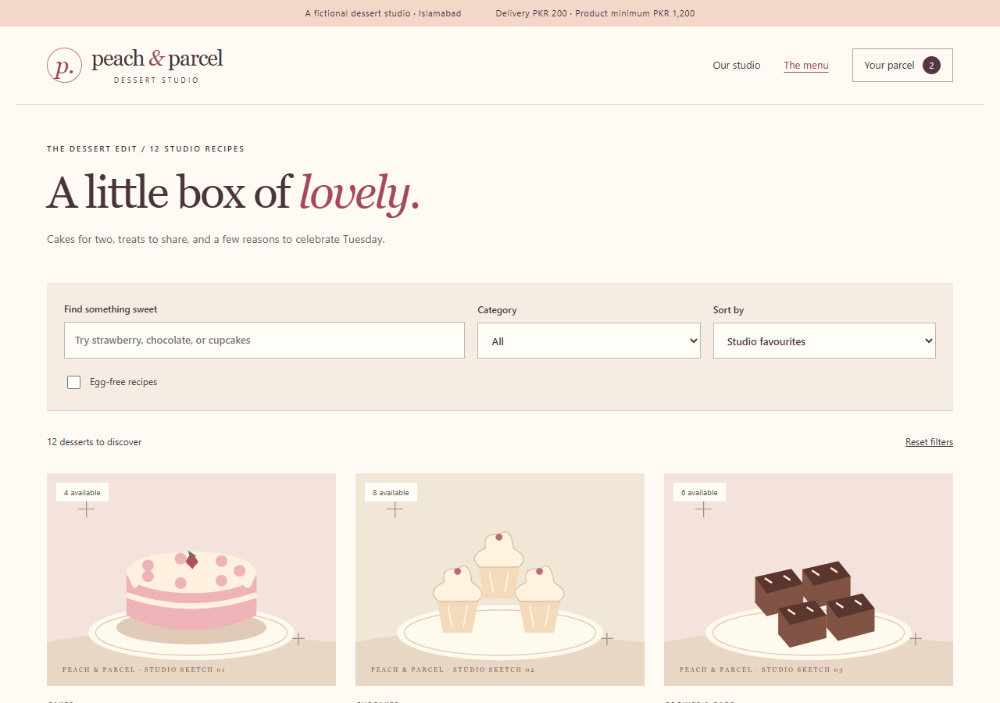

# Peach & Parcel

A React storefront for a boutique dessert studio, with a complete journey from product discovery to order review.

[Explore the source](https://github.com/alishba-1805/peach-and-parcel-react) · [Design decisions](DECISIONS.md) · [Testing](docs/TESTING.md)



## Overview

Peach & Parcel brings together a twelve-product dessert collection, clear product information, a persistent shopping cart and a validated checkout. The interface uses a warm cream, peach and plum palette, original dessert illustrations and responsive layouts.

The collection includes cakes, cupcakes, cookies, bars and dessert cups. Delivery coverage is defined for **F-6, F-7, F-8, G-9 and G-10, Islamabad**.

## Features

- Search product names, descriptions and categories without case sensitivity.
- Combine category and egg-free filters with ascending or descending price sorting.
- View serving sizes, recipe information, prices and available stock before adding products.
- Add, remove and adjust quantities from a shared cart that survives page reloads.
- Receive specific feedback for stock conflicts, delivery eligibility and invalid form fields.
- Review itemized totals, a fixed delivery fee and progress toward the product minimum.
- Complete checkout with an itemized confirmation that remains available after refresh.
- Recover from loading failures, empty results, unavailable products and damaged saved-cart data.
- Navigate the main journey using a keyboard at desktop and mobile widths.

## Technology

| Area                  | Implementation                                            |
| --------------------- | --------------------------------------------------------- |
| Interface             | React, JavaScript and semantic HTML                       |
| Routing               | React Router DOM                                          |
| Styling               | Authored responsive CSS                                   |
| Development and build | Vite                                                      |
| Data                  | Local JavaScript catalog and asynchronous loader          |
| Persistence           | localStorage for the cart; sessionStorage for the receipt |
| Unit testing          | Node.js built-in test runner                              |
| Browser verification  | Playwright with Microsoft Edge                            |

## Getting started

Use Node.js **22.12 or later** and npm. Development was verified with Node.js 24.11.0.

```bash
git clone https://github.com/alishba-1805/peach-and-parcel-react.git
cd peach-and-parcel-react
npm install
npm run dev
```

Open the local address printed by Vite.

| Command           | Purpose                                         |
| ----------------- | ----------------------------------------------- |
| `npm run dev`     | Start the development server                    |
| `npm test`        | Run the business-rule, storage and loader tests |
| `npm run build`   | Create the production build in dist             |
| `npm run preview` | Serve the production build locally              |

## Application routes

| Route            | Purpose                                                     |
| ---------------- | ----------------------------------------------------------- |
| `/`              | Studio introduction and delivery information                |
| `/shop`          | Product collection, search, filtering and sorting           |
| `/products/:id`  | Product details, availability and quantity selection        |
| `/cart`          | Selected products, quantity controls and calculated summary |
| `/checkout`      | Delivery details, recipe preference and validation          |
| `/confirmation`  | Itemized order summary                                      |
| Unmatched routes | Helpful not-found page with a return to the menu            |

## Ordering rules

Business logic lives in [src/utils/rules.js](src/utils/rules.js). Components and automated tests use the same exported functions.

| Rule                 | Behavior                                                                                                                      | Boundary                                                                    |
| -------------------- | ----------------------------------------------------------------------------------------------------------------------------- | --------------------------------------------------------------------------- |
| Availability         | Quantities must be positive whole numbers within current stock. Invalid selections remain visible until corrected or removed. | With stock 4, quantities 2 and 4 pass; 5 fails.                             |
| Recipe compatibility | Selecting egg-free-only requires every cart item to carry an egg-free recipe label. Conflicts identify the affected product.  | One incompatible item blocks confirmation while the preference is selected. |
| Delivery             | Product subtotal must reach PKR 1,200. A separate PKR 200 delivery fee is added. Only the five listed sectors are accepted.   | PKR 1,199 fails; PKR 1,200 passes, giving a PKR 1,400 total with delivery.  |

Stock appears on product cards and detail pages, with conflicts explained in the cart and checkout. Recipe labels appear beside serving information. Delivery terms are disclosed before checkout, and the summary shows the exact shortfall below the minimum. Eligible selections can continue; invalid selections receive specific feedback and block completion.

Recipe labels describe the catalog data; they are not allergy or cross-contamination guarantees.

## Project structure

```text
src/
  components/       Shared navigation, product, quantity and summary components
  data/             Product catalog
  pages/            Route components
  utils/            Business rules, loading and persistence
  App.jsx           Shared cart, catalog and browsing state
  main.jsx          Application entry point
  styles.css        Visual system and responsive layouts
public/
  images/           Original local illustrations and image fallback
tests/              Node.js rule, storage and loader tests
scripts/            Illustration and browser-check utilities
docs/               Deployment, testing, asset notes and preview images
```

## State and implementation

App owns the cart, catalog and browsing filters. Route components receive the values and callback props they need, keeping counts, quantities and summaries consistent.

The pure functions in src/utils/rules.js handle availability, compatibility, delivery eligibility and totals. The asynchronous catalog loader supports loading, cancellation and recovery states.

Browsing filters are retained when returning from product details within the same visit. The cart persists across reloads. Saved IDs are checked against current product data, with explicit recovery for outdated entries.

## Testing and recovery

Recorded verification covers **40 passing Node.js tests** and **116 passing browser assertions**, including complete journeys at 390px and 1280px, keyboard interaction, storage recovery, asset loading and horizontal-overflow checks. The browser run recorded no console errors or warnings. See [the testing guide](docs/TESTING.md) for coverage and reproduction steps.

To repeat browser checks, install the optional tooling without adding it to the application dependencies:

```bash
npm install --no-save --package-lock=false playwright
npm run build
npm run preview
```

Keep preview running, then use another terminal:

```bash
node scripts/run-browser-checks.mjs
```

The runner uses Microsoft Edge and the local preview at http://127.0.0.1:4173. Generated screenshots and results are saved under .cache/ and remain outside version control.

The footer's **Catalog scenarios** disclosure provides reproducible recovery checks:

1. **Simulate loading failure** rejects the catalog request. **Retry loading** restores the products.
2. **Simulate empty catalog** returns zero records. **Restore catalog** restores the collection. Searching for `zzzz` instead shows a separate no-matches state with **Reset filters**.
3. **Reduce stock** changes Strawberry Sunday Bento stock to 0 and Vanilla Cloud Cupcakes stock to 2. Add four first to inspect a retained quantity conflict.
4. **Reset catalog** restores ordinary catalog data and stock without clearing the cart.

Malformed saved JSON, unknown IDs, missing images, invalid URLs and form recovery are documented in [TESTING.md](docs/TESTING.md).

## Scope and privacy

This is a frontend implementation using local catalog data and **simulated checkout**. No payment, real order or delivery request is submitted. Use sample information in the delivery form.

Customer name, phone and address stay in component memory. The cart stores only product IDs and quantities; the receipt stores only product names, prices, quantities, totals and a reference. Cross-tab synchronization and live inventory are outside the current scope.

## Documentation and deployment

- [Design decisions](DECISIONS.md): interface choices, alternatives and tradeoffs.
- [Asset notes](docs/ASSETS.md): original illustrations and fallback assets.
- [Testing guide](docs/TESTING.md): automated checks and recovery scenarios.
- [Deployment guide](docs/DEPLOYMENT.md): Vercel settings and release verification.
- [Mobile preview](docs/images/storefront-mobile.png): the storefront at 390px.

Vercel configuration is included for client-side routing. Public deployment remains pending.

## Author

**[Alishba Inam](https://github.com/alishba-1805)**
**Roll number:** 24i-2036
BS Cyber Security · FAST-NUCES, Islamabad
